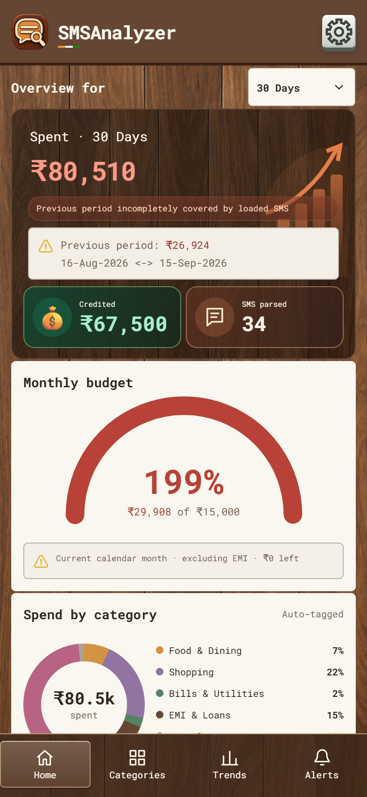
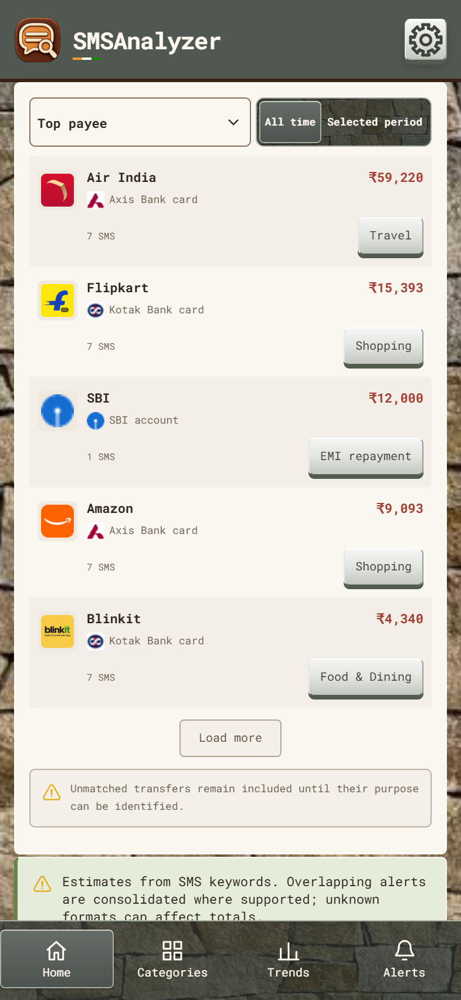
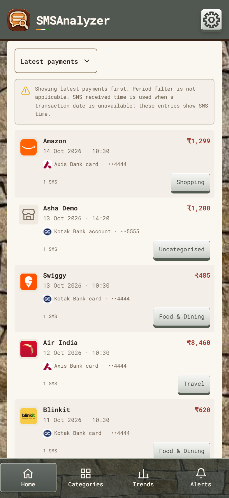
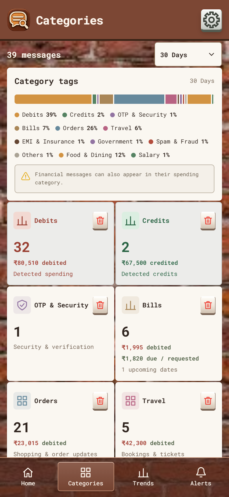
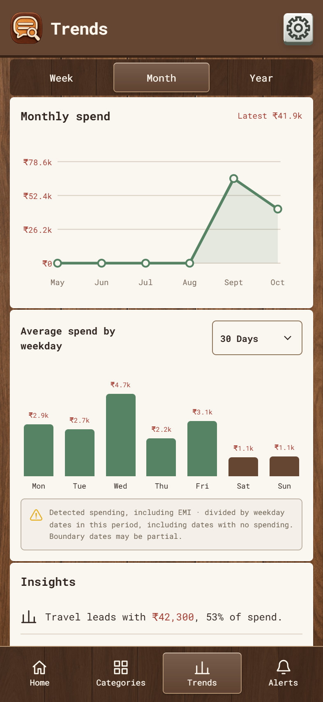
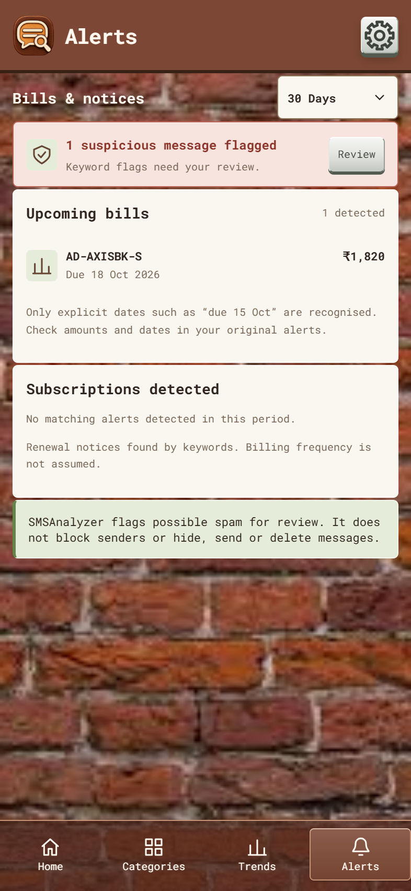
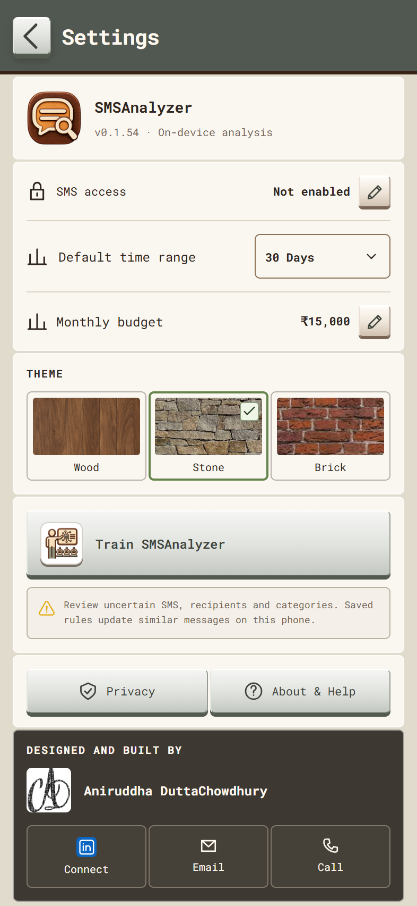
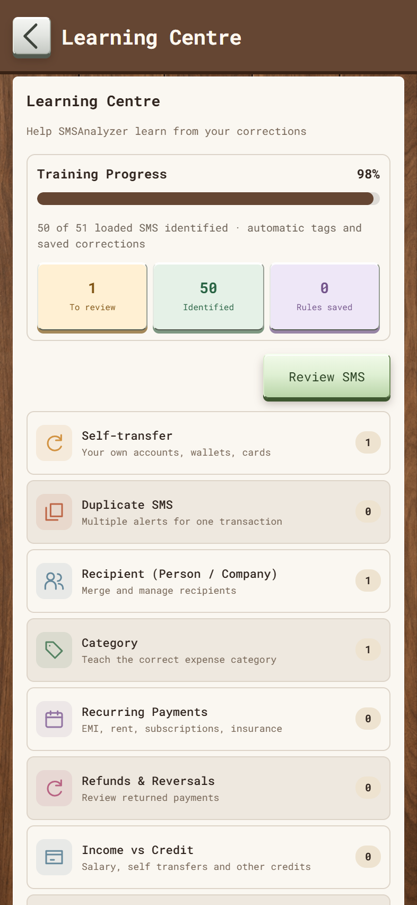

# SMSAnalyzer

Android SMS insights and local learning by **Aniruddha DuttaChowdhury** · **ADChowdhury**.

**Latest version:** 0.1.54 · **Application ID:** `app.adc.smsanalyzer`

[Download the latest APK](https://github.com/aniruddhaKol/SMSAnalyzer/releases/latest) · [Release notes](docs/release-v0.1.54.md) · [Screenshot details](docs/SCREENSHOTS.md)

SMSAnalyzer reads permitted inbox messages on the device, identifies payments and credits, groups spending, and lets you correct classifications through a Learning Centre. The interface follows the TaskVilla Wood, Stone and Brick themes.

## Screenshots

These are actual v0.1.54 interface renders with **synthetic sample SMS**, not a real inbox. Native Android system bars are not included. Select an image to see it at full resolution.

| Home overview · Wood | Top payee · Stone |
| --- | --- |
|  |  |

| Latest payments · Stone | Categories · Brick |
| --- | --- |
|  |  |

| Trends · Wood | Alerts · Brick |
| --- | --- |
|  |  |

| Settings · Stone | Learning Centre · Wood |
| --- | --- |
|  |  |

## Features

- Home spending and credit summaries, previous-period comparison and monthly budget. Budget excludes EMI repayments, verified self-transfers and card settlements.
- **Top payee** aggregates identified recipients for All time or the selected period. **Latest payments** shows individual outgoing payments, newest first, with five more records per Load more action. Its period toggle is hidden; returning to Top payee restores the previous selection.
- Latest payments uses an extracted transaction date/time when supported and labels SMS received-time fallback. Existing duplicate and payment-treatment rules exclude duplicate notices, internal movements and non-payments.
- Category amounts, source SMS previews, spending trends, bill/OTP/spam estimates and bank/merchant icons.
- Learning Centre under Settings: correct recipients, categories, income and self-transfers; preview historical matches; save reusable rules or individual corrections; undo saved corrections; add custom categories.
- Conservative multipart reconstruction and related-message learning. Separate messages are not merged merely because they arrive together.
- Pull to refresh; long-press displayed SMS content to copy the full message. Dropdowns dismiss on outside taps.

## Data and privacy

The Android shell requests **READ_SMS**. It does not request Internet or SMS-send permissions. Original imported SMS payloads are retained in an encrypted local SQLite archive using an Android Keystore key; analysis and learning remain on the device. Refresh adds records without purging messages removed from the inbox. There is no automatic archive expiry.

Import runs on app open and pull to refresh. Messages deleted before their first import cannot be recovered. Uninstalling or clearing app data removes the local archive and key. The UI has no archive/export block; an export is performed only following an explicit request outside the app. Personal inboxes, learned recipient data, archives and signing keys are not included in this repository or release assets.

SMS interpretation is heuristic: unsupported wording, unclear ownership, transaction-date formats and overlapping alerts can affect results. The app keeps originals available for review. It does not send or delete inbox SMS.

## Install

Download `smsanalyzer-v0.1.54.apk` from the [release](https://github.com/aniruddhaKol/SMSAnalyzer/releases/tag/v0.1.54), install it on Android 8.0/API 26 or newer, then grant SMS access when requested. Pull down on Home to refresh.

This is the current development/review build. The released APK retains the existing signing identity for compatible updates. A locally rebuilt APK signed with a different key cannot replace that installation as an in-place update.

## Source layout

| Path | Purpose |
| --- | --- |
| `ui/` | HTML/CSS/JavaScript interface, classification, learning and assets |
| `android/src/` | Java WebView shell and encrypted SQLite archive |
| `android/res/` | Android resources and launcher artwork |
| `android/build.ps1` | Build, align and sign the APK; copies `ui/` into Android assets |
| `docs/screenshots/` | Eight synthetic-data screenshots embedded above |
| `scripts/` | Reproducible screenshot capture |

## Build

Requires Windows PowerShell, Android SDK platform 36/build-tools 36.0.0 and JDK 27 (the existing script uses `C:/jdk-27`). The SDK defaults to `%LOCALAPPDATA%/Android/Sdk`.

```powershell
./android/build.ps1
```

The script uses the existing local review keystore when present and generates a new local review key when it is absent. Signing files are ignored by Git. Keep the original key privately if producing updates for existing installations; generating another key changes signature compatibility. Output is written under `android/releases/v0.1.54/`.

## Reproduce screenshots

Install Node.js, Playwright and Microsoft Edge, then run:

```powershell
npm install --no-save playwright
node scripts/capture-screenshots.cjs
```

Use `SCREENSHOT_BROWSER` to choose another installed Playwright Chromium channel. The script generates synthetic messages only; it never connects to a phone.

## Validation

Run the included dropdown, period restoration and control-alignment check after installing Playwright:

```powershell
node scripts/verify-ui.cjs
```

v0.1.54 was built and installed on Galaxy S25 with the existing package and signing certificate. Browser geometry checks confirmed matching 42px dropdown/toggle height and alignment at 320, 360 and 393px. Recent regression checks cover category navigation, financial classification and learning, archive retention/encryption, multipart/context matching, long-press copy, payment pagination, date fallback and dropdown dismissal. See the [version guide](docs/v0.1.54-guide.md).

## Attribution

Roboto Mono is included under the [SIL Open Font License](ui/assets/fonts/RobotoMono-OFL.txt). Bank and merchant marks identify transaction sources; they belong to their respective owners and do not imply endorsement. See [artwork attribution](ui/assets/brands/ATTRIBUTION.txt) and [retrieved sources](ui/assets/brands/sources.json). TaskVilla-style themes and the ADChowdhury signature are reused at the author's direction.
